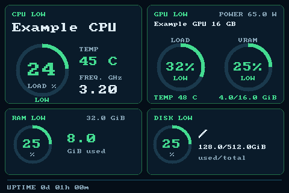

# turing-screen-monitor

[](https://crates.io/crates/turing-screen-monitor)
[](https://crates.io/crates/turing-screen-monitor)
[](https://github.com/revengator/turing-screen-monitor/releases/latest)
[](LICENSE)

A Linux system monitor for **Turing revision A 3.5-inch USB displays**, rendered
at 480 × 320 in landscape. Implemented in Rust; Python is used only for development
checks and profiling.



## Supported hardware and data

Supports revision A 3.5-inch displays with USB ID `1a86:5722` on Linux.
Other revisions and screen sizes are unsupported.
The display keeps a fixed set of measurements:

- CPU usage, average frequency, temperature, model and optional package power.
- NVIDIA GPU utilization and VRAM occupancy in separate circular gauges, plus
  temperature, used/total VRAM, power and model.
- RAM, root filesystem `/` usage and capacity, and uptime.

NVIDIA metrics require the existing driver and `nvidia-smi`; only the first GPU
is used. A missing sensor shows `N/A`. CPU power is hidden unless two valid,
accessible RAPL samples exist. No network or other unrelated indicators are added.
See [metric calculations, colors and limits](docs/metrics.md).

## Build and preview

An existing C linker, Bash and curl are required. Development commands keep
Rust, dependencies, caches, temporary files and builds in `.work/`:

```bash
bash tools/bootstrap-rust
bash tools/cargo-local build --release --locked
./.work/target/release/turing-screen-monitor
```

The default command writes `.work/preview.png` with real metrics without accessing
USB. Choose another destination with `--preview PATH`. For a reproducible preview
with fixed example hardware and measurements, use:

```bash
./.work/target/release/turing-screen-monitor --preview .work/demo.png --demo
```

Demo mode reads no sensors and cannot be combined with `--device`. Rust 1.90 or newer is
required; the development toolchain is pinned in `rust-toolchain.toml`.
Build and run development tools as your ordinary user.

## Use the screen

Stop any other monitor using the device, including an installed service.
Your user must already have read/write access to the serial device:

```bash
./.work/target/release/turing-screen-monitor --device auto --once
./.work/target/release/turing-screen-monitor --device auto --interval 2
```

Use `--device /dev/serial/by-id/...` for a specific display, `--brightness 20` to
set brightness, or `--reverse` for the opposite orientation. `--help` lists all
options. Ctrl+C and SIGTERM stop monitoring and leave the last image visible.

Continuous mode retries USB errors and reinitializes the screen after resume.
One-shot, frame-limited and profiling runs fail on USB errors. Permissions,
groups and udev rules are never changed automatically.

## Install and optional startup

Install the published release from [crates.io](https://crates.io/crates/turing-screen-monitor):

```bash
cargo install turing-screen-monitor --locked
```

A prebuilt static binary for Linux x86_64 (no Rust toolchain needed) is attached to
each [GitHub release](https://github.com/revengator/turing-screen-monitor/releases/latest),
with its SHA-256 checksum.

Alternatively, a Cargo installation from this checkout can remain entirely inside
the repository:

```bash
bash tools/cargo-local install --path . --locked --root "$PWD/.work/install"
./.work/install/bin/turing-screen-monitor service install --dry-run --enable --start
```

The second command only prints a plan. Explicit root installation can provide
boot startup and access to root-only RAPL counters. It uses a stable, root-owned
executable outside `.work/`. Cargo installation itself never activates a service.

See [installation, USB access, updates, removal and troubleshooting](docs/installation.md)
before installing.

## Development and release checks

```bash
bash tools/check-release --allow-dirty
```

This runs formatting, linting, Rust tests, pseudo-terminal tests and Cargo package
verification. It does not access physical USB or install a service. Run without
`--allow-dirty` for a clean release candidate. See [development](docs/development.md)
and [publication instructions](docs/releasing.md); publishing is a separate action.

Partial updates send only changed rectangles to reduce serial traffic.
Cached gauge geometry keeps CPU use low between sensor queries.

## Structure

- `src/metrics.rs` and `src/power.rs`: sensors and conditional CPU package power.
- `src/render.rs` and `src/levels.rs`: panel layout, cached gauges and visual levels.
- `src/protocol.rs` and `src/recovery.rs`: serial packets, partial updates and recovery.
- `src/service.rs`: explicit deployment, update, rollback and removal.
- `tests/`: hardware-free integration checks.
- `tools/`: repository-local tooling and profiling.
- `docs/`: installation, metric definitions, development and release instructions.

## Cleanup and license

Remove `.work/` after stopping development commands to delete local tools, caches,
previews and packages. An installed system service uses its separate executable;
removing development files does not uninstall it. Preserve any local files you
want to keep before cleanup. Service removal is documented separately.

GPL-3.0-or-later. See [LICENSE](LICENSE), [NOTICE](NOTICE) and [CHANGELOG](CHANGELOG.md).
